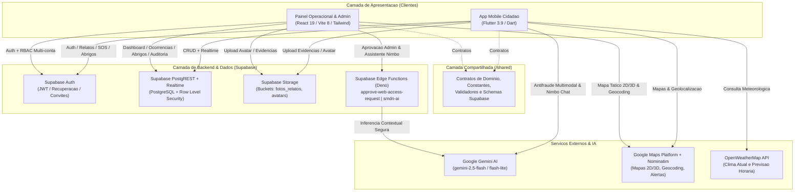
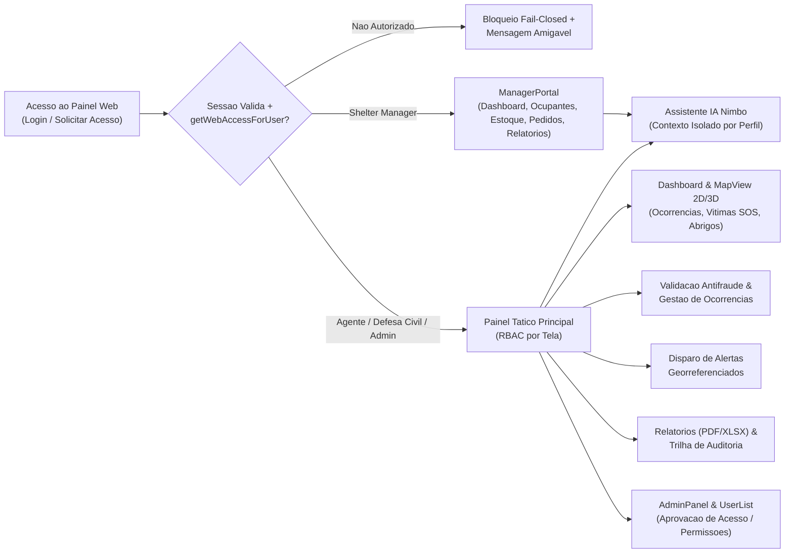
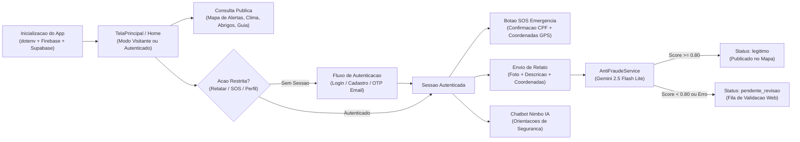
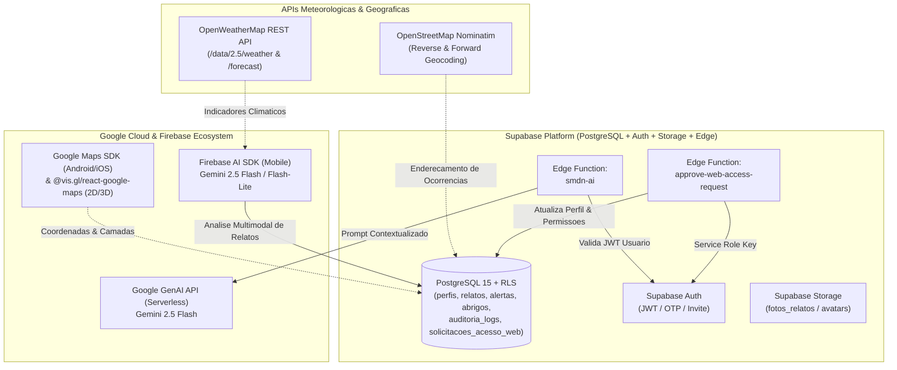

# PREVER — Plataforma de Resiliência e Vigilância de Eventos de Risco (SMDN)

> **Sistema de Monitoramento de Desastres Naturais (SMDN)** — Ecossistema integrado Web e Mobile para prevenção, alerta precoce, resposta tática a emergências climáticas, gestão de abrigos humanitários e validação antifraude assistida por Inteligência Artificial.

---

## Sumário

1. [Visão Geral](#1-visão-geral)
2. [Tecnologias](#2-tecnologias)
3. [Arquitetura](#3-arquitetura)
4. [Diagramas de Arquitetura e Fluxos (Mermaid)](#4-diagramas-de-arquitetura-e-fluxos-mermaid)
5. [Estrutura de Pastas do Monorepo](#5-estrutura-de-pastas-do-monorepo)
6. [Instalação](#6-instalação)
7. [Configuração e Variáveis de Ambiente](#7-configuração-e-variáveis-de-ambiente)
8. [Desenvolvimento](#8-desenvolvimento)
9. [Testes](#9-testes)
10. [Build de Produção](#10-build-de-produção)
11. [Deploy e CI/CD](#11-deploy-e-cicd)
12. [Segurança e DevSecOps](#12-segurança-e-devsecops)
13. [Troubleshooting](#13-troubleshooting)
14. [Roadmap](#14-roadmap)
15. [Contribuição](#15-contribuição)
16. [Licença](#16-licença)

---

## 1. Visão Geral

### Objetivo do Projeto
O **PREVER (SMDN)** é uma plataforma tecnológica integrada concebida para reduzir o tempo de resposta a desastres naturais (enchentes, alagamentos, deslizamentos de terra, quedas de árvores, vendavais e incêndios), conectando cidadãos em áreas de risco diretamente às equipes táticas da Defesa Civil, Corpo de Bombeiros, S.A.M.U., gestores de abrigos e administradores públicos.

### Problema que Resolve
Durante crises climáticas e eventos extremos, órgãos de proteção civil enfrentam três gargalos críticos:
1. **Assimetria e atraso de informação em campo**: dificuldade em mapear em tempo real onde estão as ocorrências mais graves e os cidadãos que necessitam de resgate imediato (SOS).
2. **Volume de trotes e relatos imprecisos**: sobrecarga operacional causada por denúncias falsas ou inconsistentes. O PREVER resolve isso com uma camada de **triagem antifraude multimodal via IA (Google Gemini)** e fila de validação humana.
3. **Descoordenação logística de abrigos**: falta de visibilidade em tempo real sobre lotação, ocupantes, estoque de suprimentos e pedidos emergenciais de abrigos municipais.

### Público-Alvo
- **Cidadãos e Comunidades em Áreas de Risco (`/mobile`)**: envio de relatos geolocalizados com foto, acionamento de botão SOS com confirmação de identidade, visualização de mapas de alertas ativos, consulta de abrigos próximos com cálculo de rota/distância, previsão meteorológica e suporte pelo assistente virtual **Nimbo**.
- **Agentes Operacionais, Defesa Civil e Corpo de Bombeiros (`/web`)**: monitoramento tático em mapa 2D/3D, validação antifraude de relatos, atendimento de vítimas SOS, disparo de alertas georreferenciados e emissão de relatórios analíticos (PDF/XLSX).
- **Gestores de Abrigos (`/web` — `ManagerPortal`)**: controle de ocupação, cadastro de desabrigados, inventário de estoque, solicitações de suprimentos e relatórios operacionais do abrigo.
- **Administradores Institucionais (`/web` — `AdminPanel` / `UserList`)**: aprovação de solicitações de acesso web, gestão granular de permissões RBAC por tela e auditoria completa de ações.

---

## 2. Tecnologias

### Aplicativo Mobile (`/mobile`)
| Categoria | Tecnologia / Biblioteca | Versão | Finalidade |
| :--- | :--- | :--- | :--- |
| **Framework UI** | Flutter / Material 3 | SDK `^3.9.0` | Interface nativa multiplataforma (Android / iOS / Web) |
| **Linguagem** | Dart | `^3.9.0` | Tipagem estática sound null-safety |
| **Gerenciamento de Estado** | `provider` | `^6.1.2` | Estado reativo global de acessibilidade, contraste, daltonismo e escala de fonte |
| **Backend & Auth** | `supabase_flutter` | `^2.12.4` | Autenticação JWT/OTP, PostgREST e Storage (`fotos_relatos`, `avatars`) |
| **Inteligência Artificial** | `firebase_core`, `firebase_ai` | `^4.10.0`, `^3.12.2` | Validação antifraude multimodal (`gemini-2.5-flash-lite`) e Chatbot Nimbo (`gemini-2.5-flash`) |
| **Mapas & Georreferenciamento** | `google_maps_flutter`, `geolocator`, `permission_handler` | `^2.5.3`, `^14.0.2`, `^12.0.1` | Mapas interativos, captura de coordenadas GPS e cálculo Haversine |
| **Rede & Utilitários** | `http`, `flutter_dotenv`, `file_picker`, `mask_text_input_formatter`, `url_launcher`, `flutter_svg` | Diversas | Consumo da API OpenWeatherMap, leitura de `.env`, upload de imagens e máscaras de formulário |

### Painel Web (`/web`)
| Categoria | Tecnologia / Biblioteca | Versão | Finalidade |
| :--- | :--- | :--- | :--- |
| **Biblioteca UI** | React / React DOM | `^19.2.6` | Construção declarativa das telas táticas, portais e modais |
| **Bundler & Dev Server** | Vite (`@vitejs/plugin-react`) | `^8.0.12` | Build otimizado com code-splitting e HMR |
| **Estilização** | Tailwind CSS + `@tailwindcss/forms` | `^3.3.0` | Design system responsivo, dark mode, alto contraste e suporte a daltonismo |
| **Mapas 2D e 3D** | `@vis.gl/react-google-maps` | `^1.10.1` | Renderização de mapas 2D (`Map`, `AdvancedMarker`) e 3D fotorealistas (`Map3D`, `Marker3D`) |
| **Backend & Realtime** | `@supabase/supabase-js` | `^2.108.1` | Auth multi-conta, queries PostgREST, canais Realtime, RPCs e invocação de Edge Functions |
| **Inteligência Artificial** | `@google/genai` + Supabase Edge Function `smdn-ai` | `^2.10.0` | Assistente operacional Nimbo com isolamento de contexto por perfil |
| **Exportação Documental** | `jspdf`, `html2canvas`, `xlsx` | `^4.2.1`, `^1.4.1`, `^0.18.5` | Exportação de relatórios executivos e operacionais em PDF e Excel |
| **Qualidade & Testes** | ESLint 10 + Node.js Test Runner (`node:test`) | Node 20+ | Linting estático e 30 testes automatizados de segurança, RBAC, acessibilidade e domínio |

### Backend Serverless & Banco de Dados (`/supabase`)
- **PostgreSQL 15+ com Row Level Security (RLS)**: Políticas de segurança em nível de linha em todas as tabelas operacionais (`perfis`, `relatos`, `alertas`, `abrigos`, `abrigo_ocupantes`, `abrigo_estoque`, `abrigo_pedidos`, `solicitacoes_acesso_web`, `auditoria_logs`, `atividades_usuario`).
- **Supabase Edge Functions (Deno / TypeScript)**:
  - [`approve-web-access-request`](file:///c:/Users/TAUBATE-URBANOALVESD/.gemini/antigravity-ide/scratch/Prever/supabase/functions/approve-web-access-request/index.ts): Fluxo administrativo seguro de aprovação/rejeição de solicitações de acesso ao painel web e envio de convites.
  - [`smdn-ai`](file:///c:/Users/TAUBATE-URBANOALVESD/.gemini/antigravity-ide/scratch/Prever/supabase/functions/smdn-ai/index.ts): Proxy autenticado para inferência no Google Gemini (`gemini-2.5-flash`) sem expor chaves de IA no navegador.
- **Integrações Externas**:
  - **OpenWeatherMap API**: Clima atual e previsão horária por cidade ou coordenadas GPS.
  - **OpenStreetMap Nominatim API**: Geocodificação e busca reversa de endereços/bairros.
  - **Google Maps Platform**: Mapas vetoriais, círculos de impacto e câmera 3D.

---

## 3. Arquitetura

### Arquitetura Geral e Modularização
O monorepo é organizado em quatro grandes domínios desacoplados:
1. **`/mobile` (Apresentação & Domínio Cidadão)**: Aplicação Flutter estruturada em camadas de controle (`lib/controles/`), serviços de domínio (`lib/services/`) e telas (`lib/telas/`).
2. **`/web` (Apresentação & Operação Tática/Administrativa)**: SPA React estruturada com separação clara entre clientes/serviços de backend (`src/backend/admin`, `src/backend/ai`, `src/backend/alertas`, `src/backend/auditoria`, `src/backend/auth`, `src/backend/ocorrencias`, `src/backend/perfil`, `src/backend/relatorios`, `src/backend/shelter`, `src/backend/supabase`), provedores de contexto (`src/context/`), hooks customizados (`src/hooks/`), componentes reutilizáveis (`src/components/`) e telas (`src/screens/`).
3. **`/shared` (Contratos & Utilitários Compartilhados)**: Definições canônicas de tipos (`shared/types/`), constantes de severidade e status (`shared/constants/`), validadores puros (`shared/utils/`) e contratos de tabelas/buckets/RPCs do Supabase (`shared/services/`).
4. **`/supabase` (Persistência, Segurança RLS & Funções Serverless)**: Scripts SQL numerados e idempotentes (`supabase/sql/00_master_setup.sql` a `18_antifraude_validation.sql`) e Edge Functions em Deno (`supabase/functions/`).

### Comunicação entre Web e Mobile
O aplicativo **Mobile** e o painel **Web** comunicam-se de forma assíncrona e em tempo real através do **Supabase (PostgreSQL + PostgREST + Realtime + Storage)**:
- Quando um cidadão envia um **Relato** ou aciona o botão **SOS** no `/mobile`, o registro é avaliado pelo `AntiFraudeService` (`gemini-2.5-flash-lite`) e persistido na tabela `relatos` (com imagens no bucket `fotos_relatos`).
- O painel `/web` recebe imediatamente os relatos e pedidos de socorro via consultas e canais Realtime, exibindo-os no `Dashboard`, na fila de `ValidacaoAntifraude` (quando `score < 0.80`) e na camada de vítimas do `MapView`.
- Quando operadores disparam um **Alerta** ou atualizam o status de um **Abrigo** no `/web`, os dados são refletidos imediatamente nas telas de `Maps_alertas` e `AbrigosTela` do `/mobile`.

---

## 4. Diagramas de Arquitetura e Fluxos (Mermaid)

### 4.1. Arquitetura Geral



### 4.2. Fluxo Web



### 4.3. Fluxo Mobile



### 4.4. Integrações



### 4.5. Estrutura do Monorepo

```mermaid
graph TD
    Root["/ (Raiz do Monorepo PREVER)"]
    Root --> Mobile["/mobile (App Cidadao Flutter)"]
    Root --> Web["/web (Painel Tatico React + Vite)"]
    Root --> Shared["/shared (Contratos, Constantes e Validadores)"]
    Root --> Supabase["/supabase (Migrations SQL, RLS e Edge Functions)"]
    Root --> Docs["/docs (Arquitetura e Diagramas Mermaid)"]
    Root --> Scripts["/scripts (Automacao de Qualidade e CI)"]
    Root --> Github["/.github (Workflows CI/CD GitHub Actions)"]
    Root --> Readme["/README.md & /.env.example"]

    Mobile --> MobileLib["lib/ (main, controles, services, telas)"]
    Mobile --> MobileAssets["assets/ & gfx/ (icones e ilustracoes)"]
    Mobile --> MobileTest["test/ (unit, widget, load tests)"]

    Web --> WebSrc["src/ (backend, components, context, hooks, screens, utils)"]
    Web --> WebPublic["public/ (assets estaticos)"]
    Web --> WebTests["tests/ (30 testes automatizados de seguranca/dominio)"]

    Shared --> SharedTypes["types/ (domain.d.ts)"]
    Shared --> SharedConst["constants/ (domain.js)"]
    Shared --> SharedUtils["utils/ (validators.js)"]
    Shared --> SharedServices["services/ (supabaseContracts.js)"]

    Docs --> DocsDiag["diagrams/ (*.mmd)"]
    Docs --> DocsArch["architecture/ (*.md)"]
```



---

## 5. Estrutura de Pastas do Monorepo

```text
/
├── mobile/                                 # Aplicativo Mobile Cidadão (Flutter / Dart)
│   ├── android/                            # Projeto nativo Android (Gradle Kotlin DSL)
│   ├── ios/                                # Projeto nativo iOS (Xcode / Runner)
│   ├── web/                                # Suporte web do Flutter
│   ├── assets/                             # Recursos estáticos (imagens e ícones)
│   ├── gfx/                                # Biblioteca gráfica vetorial (SVG) e PNG
│   ├── lib/                                # Código-fonte principal do pacote Flutter
│   │   ├── controles/                      # Controlador global de acessibilidade e temas
│   │   ├── services/                       # Serviços de domínio (Antifraude IA, Relatos Próximos)
│   │   ├── telas/                          # Telas da aplicação, formatadores e widgets
│   │   ├── firebase_options.dart           # Configuração multiplataforma do Firebase via .env
│   │   └── main.dart                       # Entrypoint da aplicação Mobile
│   ├── src/                                # Índice de documentação arquitetural do código-fonte
│   ├── test/                               # Suíte executável do Flutter Test (unit, widget e carga)
│   ├── tests/                              # Índice da suíte de testes mobile
│   ├── .env.example                        # Template de variáveis de ambiente do Mobile
│   └── pubspec.yaml                        # Manifesto de dependências e assets do Flutter
│
├── web/                                    # Painel Operacional e Administrativo (React 19 + Vite 8)
│   ├── public/                             # Arquivos públicos estáticos
│   ├── src/                                # Código-fonte do frontend Web
│   │   ├── assets/                         # Ícones SVG, logotipos e imagens do painel
│   │   ├── backend/                        # Camada de serviços e integração com Supabase e IA
│   │   │   ├── admin/                      # Administração de usuários e solicitações de acesso
│   │   │   ├── ai/                         # Assistente Nimbo, políticas de segurança e contexto
│   │   │   ├── alertas/                    # Disparo e listagem de alertas da Defesa Civil
│   │   │   ├── auditoria/                  # Logs de auditoria administrativa e operacional
│   │   │   ├── auth/                       # Autenticação e verificação RBAC (fail-closed)
│   │   │   ├── ocorrencias/                # Gestão de ocorrências, vítimas SOS e antifraude
│   │   │   ├── perfil/                     # Perfil do operador, avatar e histórico de atividades
│   │   │   ├── relatorios/                 # Agregação de KPIs e séries para relatórios
│   │   │   ├── shelter/                    # Serviços de abrigos e Portal do Gestor de Abrigo
│   │   │   └── supabase/                   # Instância singleton do cliente Supabase
│   │   ├── components/                     # Componentes visuais (MapView 2D/3D, Sidebar, Modal, Nimbo)
│   │   ├── context/                        # Contextos React (AuthContext, SmdnSettingsContext)
│   │   ├── hooks/                          # Hooks customizados (useAuth, useSmdnSettings)
│   │   ├── screens/                        # Telas do painel tático e Portal do Gestor (manager/)
│   │   ├── utils/                          # Tratamento amigável de erros e formatação de telefone
│   │   ├── App.jsx                         # Roteador de telas protegido por RBAC
│   │   └── main.jsx                        # Entrypoint React
│   ├── supabase/                           # Espelho local de funções e SQL do painel web
│   ├── tests/                              # Suíte de 30 testes automatizados (node:test)
│   ├── .env.example                        # Template de variáveis de ambiente do Web
│   └── package.json                        # Scripts e dependências NPM
│
├── shared/                                 # Camada Compartilhada entre Web e Mobile
│   ├── schema/                             # Fonte Única de Verdade (domain.schema.json)
│   ├── types/                              # Tipagens e interfaces geradas (domain.d.ts)
│   ├── constants/                          # Constantes e factories de DTOs geradas (domain.js)
│   ├── utils/                              # Validadores puros (CPF SOS, coordenadas, Haversine)
│   └── services/                           # Contratos gerados de tabelas, buckets, RPCs e Edge Functions
│
├── supabase/                               # Infraestrutura de Banco de Dados e Serverless
│   ├── functions/                          # Supabase Edge Functions (Deno)
│   │   ├── approve-web-access-request/     # Aprovação segura de acesso web com Service Role
│   │   └── smdn-ai/                        # Endpoint serverless para o assistente IA Nimbo
│   └── sql/                                # Scripts SQL numerados (00 a 18) com schema, RPCs e RLS
│
├── docs/                                   # Documentação Técnica e Arquitetural
│   ├── architecture/                       # Documentos de arquitetura e diagnóstico de auditoria
│   ├── diagrams/                           # Fontes dos diagramas Mermaid (.mmd)
│   └── *.md                                # Guias operacionais (acessibilidade, admin, antifraude)
│
├── scripts/                                # Scripts utilitários de automação e verificação
│   ├── generate-shared-contracts.mjs       # Gerador automatizado de DTOs/contratos (TS/JS + Dart)
│   ├── verify-monorepo.ps1                 # Script PowerShell de validação completa (Web + Mobile)
│   └── verify-monorepo.sh                  # Script Bash de validação completa (Web + Mobile)
│
├── .github/                                # Automação de CI/CD (GitHub Actions)
│   └── workflows/
│       ├── monorepo-ci.yml                 # Gate unificado de PR/Push (Shared + Web + Mobile)
│       ├── mobile-ci.yml                   # Pipeline de formatação, análise, testes e APK do Mobile
│       └── web-deploy.yml                  # Pipeline de build e deploy do Painel Web na Vercel
│
├── .env.example                            # Template global de variáveis de ambiente
├── .gitignore                              # Regras globais de exclusão de versionamento
└── README.md                               # Documentação principal do monorepo
```

---

## 6. Instalação

### Pré-requisitos
- **Node.js**: `>= 20.x` e **npm** `>= 10.x`
- **Flutter SDK**: `>= 3.24.0` (com Dart `>= 3.9.0`)
- **Java JDK**: `17` (para build Android no `/mobile`)
- **Supabase CLI** (opcional, para deploy local de migrations e Edge Functions)

### Passo a Passo Completo

1. **Clone o repositório:**
   ```bash
   git clone https://github.com/Beto-Ribeiro/Prever.git
   cd Prever
   ```

2. **Configure os arquivos de ambiente (`.env`):**
   ```bash
   cp .env.example .env
   cp web/.env.example web/.env
   cp mobile/.env.example mobile/.env
   ```

3. **Instale as dependências do Painel Web (`/web`):**
   ```bash
   cd web
   npm ci
   cd ..
   ```

4. **Instale as dependências do Aplicativo Mobile (`/mobile`):**
   ```bash
   cd mobile
   flutter pub get
   cd ..
   ```

5. **Provisionamento do Banco de Dados Supabase (`/supabase`):**
   Execute no **SQL Editor** do seu projeto Supabase os scripts em [`supabase/sql/`](file:///c:/Users/TAUBATE-URBANOALVESD/.gemini/antigravity-ide/scratch/Prever/supabase/sql) na ordem numérica (ou execute [`00_master_setup.sql`](file:///c:/Users/TAUBATE-URBANOALVESD/.gemini/antigravity-ide/scratch/Prever/supabase/sql/00_master_setup.sql) seguido das migrações incrementais `01` a `18`).

---

## 7. Configuração e Variáveis de Ambiente

Todas as credenciais são injetadas via variáveis de ambiente. Consulte [`.env.example`](file:///c:/Users/TAUBATE-URBANOALVESD/.gemini/antigravity-ide/scratch/Prever/.env.example), [`web/.env.example`](file:///c:/Users/TAUBATE-URBANOALVESD/.gemini/antigravity-ide/scratch/Prever/web/.env.example) e [`mobile/.env.example`](file:///c:/Users/TAUBATE-URBANOALVESD/.gemini/antigravity-ide/scratch/Prever/mobile/.env.example):

| Variável | Escopo | Obrigatória | Descrição |
| :--- | :--- | :---: | :--- |
| `VITE_SUPABASE_URL` | `/web` | Sim | URL da API do projeto Supabase para o painel web |
| `VITE_SUPABASE_ANON_KEY` | `/web` | Sim | Chave pública anônima (`anon` / `publishable`) do Supabase |
| `VITE_GOOGLE_MAPS_API_KEY` | `/web` | Sim | Chave da API Google Maps JavaScript (Mapas 2D e 3D) |
| `VITE_DEV_BYPASS_AUTH` | `/web` | Não | `false` por padrão. Quando `true` em `localhost`, habilita modo de desenvolvimento |
| `VITE_DEV_BYPASS_ADMIN` | `/web` | Não | `false` por padrão. Habilita visão admin apenas quando `VITE_DEV_BYPASS_AUTH=true` |
| `SUPABASE_URL` | `/mobile` | Sim | URL da API do projeto Supabase para o app Flutter |
| `SUPABASE_ANON_KEY` | `/mobile` | Sim | Chave pública anônima do Supabase para o app Flutter |
| `OPENWEATHER_API_KEY` | `/mobile` | Sim | Chave da API OpenWeatherMap para consulta de clima atual e previsão horária |
| `GOOGLE_MAPS_API_KEY` | `/mobile` | Sim | Chave do SDK Google Maps para Android (`manifestPlaceholders`) e iOS |
| `FIREBASE_WEB_API_KEY` | `/mobile` | Sim* | Chave Firebase para inicialização do SDK `firebase_ai` (Web) |
| `FIREBASE_ANDROID_API_KEY` | `/mobile` | Sim* | Chave Firebase para inicialização do SDK `firebase_ai` (Android) |
| `FIREBASE_IOS_API_KEY` | `/mobile` | Sim* | Chave Firebase para inicialização do SDK `firebase_ai` (iOS) |
| `SUPABASE_SERVICE_ROLE_KEY` | `/supabase` | Sim | Chave administrativa usada exclusivamente nas Edge Functions |
| `GEMINI_API_KEY` | `/supabase` | Sim | Chave da API Google Gemini usada pela Edge Function `smdn-ai` |

---

## 8. Desenvolvimento

### Painel Web (`/web`)
```bash
cd web
npm run dev      # Inicia o servidor de desenvolvimento Vite (http://localhost:5173)
npm run lint     # Executa análise estática com ESLint
npm test         # Executa os 30 testes automatizados de domínio, RBAC e segurança
npm run preview  # Serve localmente o pacote de produção gerado em dist/
```

### Aplicativo Mobile (`/mobile`)
```bash
cd mobile
flutter run                        # Executa o app no dispositivo/emulador conectado
dart format .                      # Formata todo o código Dart segundo o guia oficial
flutter analyze                    # Executa análise estática rigorosa do código Dart
flutter test                       # Executa todos os testes unitários, de widget e de carga
```

### Validação Integrada do Monorepo (`/scripts`)
```powershell
# No Windows (PowerShell):
./scripts/verify-monorepo.ps1
```
```bash
# No Linux / macOS (Bash):
bash ./scripts/verify-monorepo.sh
```

---

## 9. Testes

### Testes do Painel Web (`/web/tests`)
O painel web conta com **30 testes automatizados** executados via `npm test` (`node --test --experimental-test-module-mocks tests/*.test.js`), cobrindo:
- [`accessibility-preferences.test.js`](file:///c:/Users/TAUBATE-URBANOALVESD/.gemini/antigravity-ide/scratch/Prever/web/tests/accessibility-preferences.test.js): Contraste WCAG nas 8 combinações de tema/contraste/daltonismo e persistência de preferências.
- [`nimbo-context.test.js`](file:///c:/Users/TAUBATE-URBANOALVESD/.gemini/antigravity-ide/scratch/Prever/web/tests/nimbo-context.test.js): Isolamento de contexto do assistente IA por perfil, bloqueio contra escalonamento de privilégios por gerentes de abrigo e sanitização de erros.
- [`screen-context.test.js`](file:///c:/Users/TAUBATE-URBANOALVESD/.gemini/antigravity-ide/scratch/Prever/web/tests/screen-context.test.js): Exclusão estrita de campos de senha/segredos na captura de tela do assistente e proteção contra leitura de sessão alheia.
- [`shelter-manager-access.test.js`](file:///c:/Users/TAUBATE-URBANOALVESD/.gemini/antigravity-ide/scratch/Prever/web/tests/shelter-manager-access.test.js): Regras RBAC de acesso para gerentes de abrigo e preservação de perfis canônicos.
- [`shelter-occupants-stats.test.js`](file:///c:/Users/TAUBATE-URBANOALVESD/.gemini/antigravity-ide/scratch/Prever/web/tests/shelter-occupants-stats.test.js), [`shelter-Report-export.test.js`](file:///c:/Users/TAUBATE-URBANOALVESD/.gemini/antigravity-ide/scratch/Prever/web/tests/shelter-Report-export.test.js), [`shelter-Reports-period.test.js`](file:///c:/Users/TAUBATE-URBANOALVESD/.gemini/antigravity-ide/scratch/Prever/web/tests/shelter-Reports-period.test.js): Cálculos estatísticos de ocupantes e exportação de relatórios por período.
- [`friendly-messages.test.js`](file:///c:/Users/TAUBATE-URBANOALVESD/.gemini/antigravity-ide/scratch/Prever/web/tests/friendly-messages.test.js) e [`profile-activity.test.js`](file:///c:/Users/TAUBATE-URBANOALVESD/.gemini/antigravity-ide/scratch/Prever/web/tests/profile-activity.test.js): Sanitização de mensagens de erro técnicas e formatação de trilha de atividades.

### Testes do Aplicativo Mobile (`/mobile/test`)
O aplicativo mobile conta com **26 casos de teste** executados via `flutter test`, cobrindo:
- [`carga_relatos_test.dart`](file:///c:/Users/TAUBATE-URBANOALVESD/.gemini/antigravity-ide/scratch/Prever/mobile/test/carga_relatos_test.dart): Regras de negócio de severidade, limiar antifraude (`score >= 0.80`), fallback de precaução e simulação de carga concorrente (1, 5, 10, 25 e 50 relatos simultâneos).
- [`login_tela_test.dart`](file:///c:/Users/TAUBATE-URBANOALVESD/.gemini/antigravity-ide/scratch/Prever/mobile/test/login_tela_test.dart): Fluxos de login/logout repetidos e responsividade em telas compactas com escala de fonte ampliada.
- [`relatos_proximos_test.dart`](file:///c:/Users/TAUBATE-URBANOALVESD/.gemini/antigravity-ide/scratch/Prever/mobile/test/relatos_proximos_test.dart): Carregamento de relatos próximos, retry de geolocalização e tratamento de falha de miniatura.
- [`prever_logo_test.dart`](file:///c:/Users/TAUBATE-URBANOALVESD/.gemini/antigravity-ide/scratch/Prever/mobile/test/prever_logo_test.dart) e [`widget_test.dart`](file:///c:/Users/TAUBATE-URBANOALVESD/.gemini/antigravity-ide/scratch/Prever/mobile/test/widget_test.dart): Testes de renderização de componentes e smoke test.

---

## 10. Build de Produção

### Painel Web (`/web`)
```bash
cd web
npm run build
```
O pacote otimizado e minificado é gerado em `web/dist/`.

### Aplicativo Mobile (`/mobile`)
```bash
cd mobile
# Android APK (Release)
flutter build apk --release --dart-define=GOOGLE_MAPS_API_KEY=$GOOGLE_MAPS_API_KEY

# Android App Bundle (Google Play)
flutter build appbundle --release

# iOS (em macOS com Xcode)
flutter build ipa --release
```

---

## 11. Deploy e CI/CD

O repositório possui pipelines automatizados no GitHub Actions em [`.github/workflows/`](file:///c:/Users/TAUBATE-URBANOALVESD/.gemini/antigravity-ide/scratch/Prever/.github/workflows):

1. **Gate Unificado do Monorepo ([`.github/workflows/monorepo-ci.yml`](file:///c:/Users/TAUBATE-URBANOALVESD/.gemini/antigravity-ide/scratch/Prever/.github/workflows/monorepo-ci.yml))**:
   - Acionado em todo `pull_request` e `push` na branch `main`.
   - Executa [`scripts/verify-monorepo.sh`](file:///c:/Users/TAUBATE-URBANOALVESD/.gemini/antigravity-ide/scratch/Prever/scripts/verify-monorepo.sh), validando a sincronização dos DTOs de `/shared` (`generate-shared-contracts.mjs --check`), lint, testes e build de produção de `/web`, além de formatação, `flutter analyze --fatal-infos --fatal-warnings` e `flutter test` de `/mobile`.

2. **Painel Web ([`.github/workflows/web-deploy.yml`](file:///c:/Users/TAUBATE-URBANOALVESD/.gemini/antigravity-ide/scratch/Prever/.github/workflows/web-deploy.yml))**:
   - Acionado em `push` e `pull_request` na branch `main` quando arquivos em `web/**` são alterados.
   - Executa build e publicação automatizada na **Vercel** utilizando `VERCEL_TOKEN`, `VERCEL_ORG_ID` e `VERCEL_PROJECT_ID`.
   - Configuração de roteamento SPA (`rewrites` para `/index.html`) definida em [`web/vercel.json`](file:///c:/Users/TAUBATE-URBANOALVESD/.gemini/antigravity-ide/scratch/Prever/web/vercel.json).

3. **Aplicativo Mobile ([`.github/workflows/mobile-ci.yml`](file:///c:/Users/TAUBATE-URBANOALVESD/.gemini/antigravity-ide/scratch/Prever/.github/workflows/mobile-ci.yml))**:
   - Acionado em `push` e `pull_request` na branch `main` para alterações em `mobile/**`.
   - Executa `flutter pub get`, verificação estrita de formatação (`dart format --output=none --set-exit-if-changed .`), análise estática (`flutter analyze`), suíte de testes (`flutter test`) e compilação do APK (`flutter build apk --release`).

4. **Supabase Edge Functions (`/supabase/functions`)**:
   ```bash
   supabase functions deploy approve-web-access-request
   supabase functions deploy smdn-ai
   ```

---

## 12. Segurança e DevSecOps

As seguintes práticas de segurança (alinhadas ao **OWASP Top 10**) estão implementadas no projeto:

- **Zero Segredos Hardcoded (A02:2021 — Cryptographic Failures / A05:2021 — Security Misconfiguration)**:
  - Nenhuma chave de API (`OpenWeatherMap`, `Google Maps`, `Supabase`, `Firebase`, `Gemini`) reside no código-fonte ou em arquivos versionados.
  - `.gitignore` bloqueia estritamente qualquer variação de `.env`, `google-services.json`, `GoogleService-Info.plist`, `.keystore`, `.jks` e `.pem`.
- **Controle de Acesso Quebrado Prevenido (A01:2021 — Broken Access Control)**:
  - No banco de dados, **Row Level Security (RLS)** garante que apenas operadores com `prf_acesso_web = true` ou `prf_admin_web = true` acessem visões administrativas.
  - No painel web, `getWebAccessForUser` opera em modo **fail-closed**: se o perfil não possuir autorização explícita, a sessão é encerrada imediatamente.
  - O bypass de desenvolvimento (`VITE_DEV_BYPASS_AUTH`) exige simultaneamente `import.meta.env.DEV === true`, `window.location.hostname === 'localhost' | '127.0.0.1'` e flag explícita.
- **Proteção contra Vazamento de Dados e Prompt Injection em IA (OWASP LLM Top 10)**:
  - `screenContextService.js` remove inputs de senha, campos com `data-nimbo-ignore` e valida que o DOM pertence à conta e tela ativas antes de capturar contexto.
  - `smdnContextService.js` e `assistantPolicy.js` restringem as tabelas consultadas pelo assistente Nimbo estritamente às permissões do usuário autenticado.
- **Tratamento Seguro de Exceções e Logs (CWE-209 / CWE-532)**:
  - Mensagens técnicas de banco/rede são convertidas por `toFriendlyMessage` antes de exibição ao usuário, sem expor stack traces, URLs internas ou tokens.
  - Nenhum dado sensível (como senhas ou tokens) é impresso em console (`debugPrint` / `console.log`).

---

## 13. Troubleshooting

| Sintoma / Problema | Causa Provável | Solução |
| :--- | :--- | :--- |
| **Painel Web exibe erro ao iniciar: *"Não foi possível iniciar o sistema"*** | Variáveis `VITE_SUPABASE_URL` ou `VITE_SUPABASE_ANON_KEY` ausentes em `web/.env`. | Copie `web/.env.example` para `web/.env` e preencha a URL e Anon Key do Supabase. |
| **Clima no App Mobile exibe *"Chave da API de clima não configurada"*** | Variável `OPENWEATHER_API_KEY` vazia em `mobile/.env`. | Adicione uma chave válida da API OpenWeatherMap em `mobile/.env` e reinicie o app. |
| **Mapa Android fica em branco no App Mobile** | `GOOGLE_MAPS_API_KEY` não foi injetada no Gradle. | Defina `GOOGLE_MAPS_API_KEY` nas variáveis de ambiente ou em `mobile/android/local.properties`. |
| **Falha no teste `nimbo-context.test.js` ao rodar `node --test` diretamente** | O mock de módulos ES no Node 20/22/24 requer a flag experimental. | Utilize `npm test` dentro de `/web` (que já inclui `--experimental-test-module-mocks`). |
| **Assistente Nimbo no Web retorna indisponibilidade temporária** | Edge Function `smdn-ai` não publicada ou secret `GEMINI_API_KEY` ausente no Supabase. | Configure `supabase secrets set GEMINI_API_KEY=...` e faça deploy da função `smdn-ai`. |

---

## 14. Roadmap

- [ ] **Notificações Push Georreferenciadas (FCM / APNs)**: Envio automático de alertas críticos em segundo plano para dispositivos móveis dentro do raio de impacto.
- [ ] **Modo Offline-First para Relatos em Campo**: Armazenamento local criptografado (SQLite/Hive) para sincronização automática de relatos e SOS quando a conectividade for restabelecida.
- [ ] **Integração com Sensores Hidrometeorológicos e CEMADEN**: Ingestão automatizada de pluviômetros e radares meteorológicos oficiais no mapa tático.
- [x] **Unificação de Pacote de Contratos via Workspace**: Geração automatizada de código para Dart e TypeScript/ESM a partir de [`shared/schema/domain.schema.json`](file:///c:/Users/TAUBATE-URBANOALVESD/.gemini/antigravity-ide/scratch/Prever/shared/schema/domain.schema.json).

---

## 15. Contribuição

1. Crie uma branch a partir de `main` seguindo o padrão `feat/nome-da-feature`, `fix/nome-da-correcao` ou `docs/nome-da-doc`.
2. Certifique-se de que nenhuma chave, token ou arquivo `.env` real foi adicionado ao stage (`git status`).
3. Execute o script de verificação do monorepo antes de abrir o Pull Request:
   - Windows: `./scripts/verify-monorepo.ps1`
   - Linux/macOS: `bash ./scripts/verify-monorepo.sh`
4. Garanta que `npm run lint` e `npm test` (em `/web`) e `dart format --output=none --set-exit-if-changed .`, `flutter analyze` e `flutter test` (em `/mobile`) passem com zero erros.

---

## 16. Licença

Este projeto é distribuído sob a licença **MIT** para fins acadêmicos, institucionais e de proteção civil comunitária. Consulte a documentação institucional do projeto **PREVER (SMDN)** para mais detalhes.
